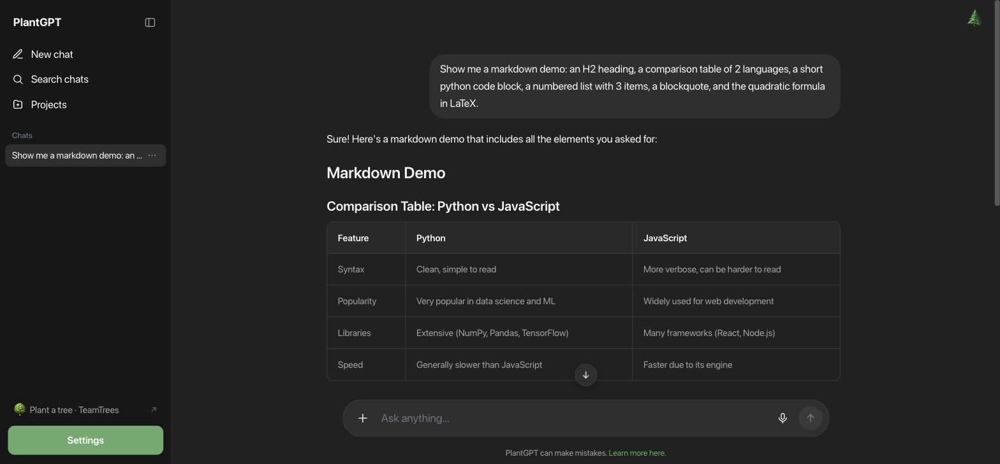

# PlantGPT



Pixel-parity desktop clone of [ecogpt.com](https://ecogpt.com) ("Regenerative AI") built with
Tauri v2 + React + Vite — except it's **100% local and free**: inference runs through
[Ollama](https://ollama.com) on your own machine. No accounts, no keys, no cloud AI, no ads,
no cost. The app sends anonymous usage counts and nothing about your chats
(see [Usage counts](#usage-counts)).

## Install

1. Download the latest `PlantGPT_x.y.z_aarch64.dmg` from
   [Releases](https://github.com/Blueturboguy07/plantgpt/releases/latest), open it, and drag
   **PlantGPT** into Applications. The app is Developer ID–signed and notarized by Apple.
2. Install [Ollama](https://ollama.com) and start it:
   `brew install ollama && brew services start ollama`
3. Pull a chat model: `ollama pull qwen2.5:3b` (or `qwen2.5:7b` if you have ≥16 GB RAM).
4. Open PlantGPT — it finds Ollama at `localhost:11434` automatically.

## What's cloned (and what's upgraded)

| Area | Parity | Notes |
| --- | --- | --- |
| Sidebar, empty state, input pill, tools menu | ✅ pixel-matched | tokens extracted from the real site (`UI-SPEC.md`) |
| Chat thread (user bubbles / plain assistant text, action row) | ✅ | |
| Impact drawer (isometric field, trees/CO2/H2O/light, badges, About/Friends/Rankings) | ✅ | stats computed locally, 1 tree per 100 messages |
| Search chats modal (⌘K), chat history, rename/delete | ✅ | |
| Projects | ✅ upgraded | real site gates them behind login; here they work locally |
| Markdown rendering | ⬆️ **better than the original** | real headings, numbered lists, green blockquotes, code blocks with language header + copy + syntax highlighting, KaTeX math, rounded tables |
| Web search | ⬆️ free + local | DuckDuckGo HTML results fetched natively and fed as context |
| Study mode | ⬆️ unlocked | tutoring system prompt (login-gated upstream) |
| Login/ads/third-party analytics | ❌ intentionally dropped | replaced by a Settings modal (model, theme, username) |

## Usage counts

Since 0.1.1 PlantGPT sends two anonymous events to publik: `app_opened` (one time for each
launch) and `active_session` (every 30 minutes while the app runs). Each event holds the app
name, the app version, the operating system, the CPU type and a random install ID. No chats,
no prompts, no file names and no user name are sent. To turn it off, set `DO_NOT_TRACK=1` in
the environment, or put `{"usage": false}` in
`~/Library/Application Support/publik/consent.json`. Details: https://publikhq.com/skills/telemetry.md

## Develop

```sh
npm install
npm run tauri dev
```

## Build

```sh
npm run tauri build
# → src-tauri/target/release/bundle/macos/PlantGPT.app (+ .dmg)
```

## Keyboard

- `⌘K` — search chats
- `⌘J` — new chat
- `Enter` send · `Shift+Enter` newline
